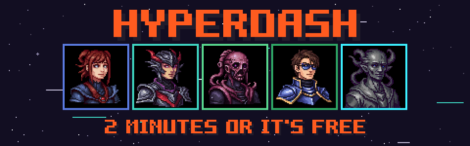
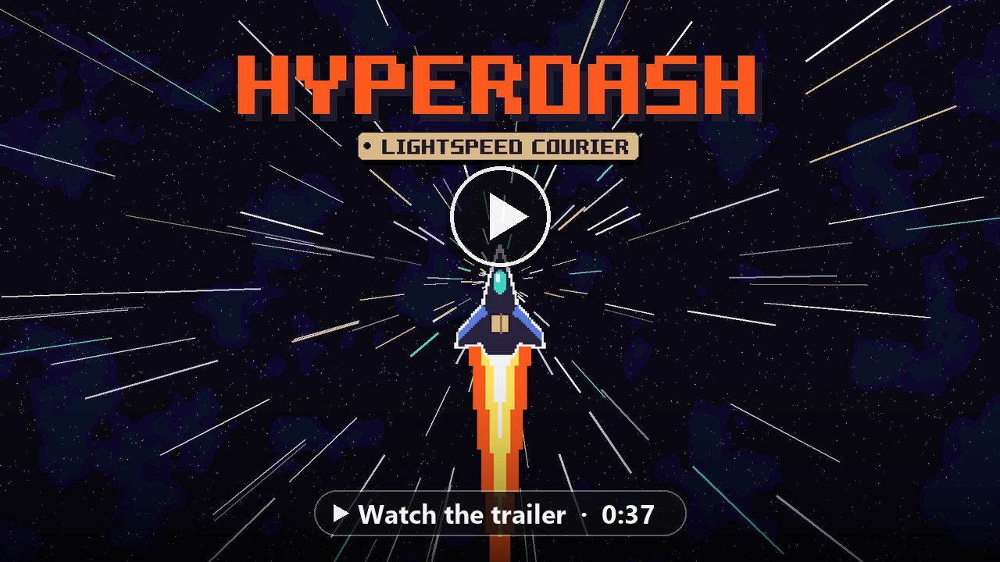
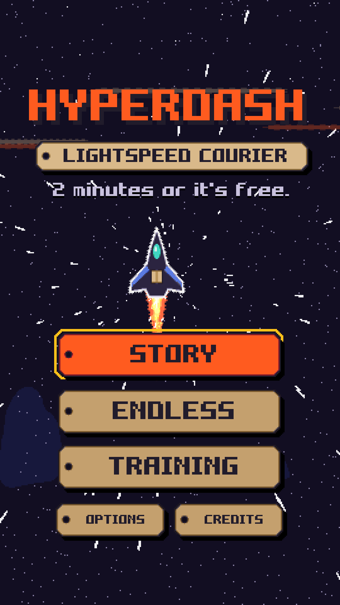
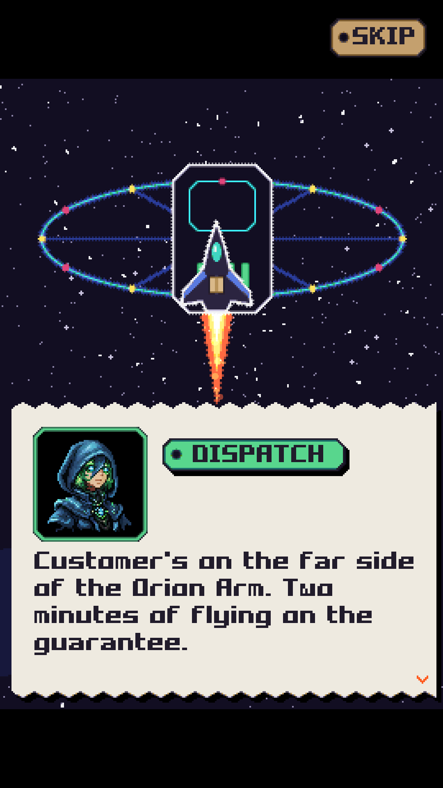
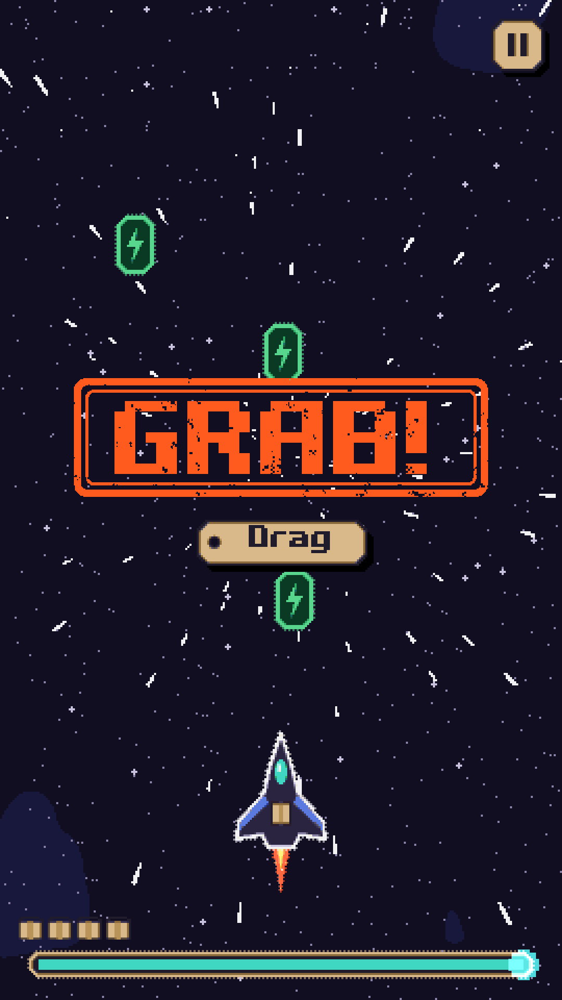
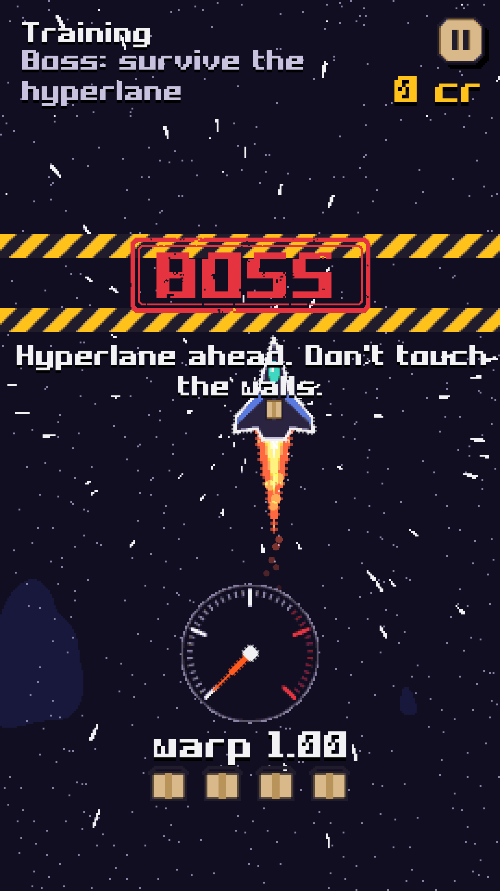

# HYPERDASH: Lightspeed Courier

<p align="center">
  
</p>

A fast sci-fi microgame gauntlet made for SlapJam #2 (theme: **SPEED**).
Five couriers relay one parcel across the galaxy on a two-minute delivery guarantee,
in ships that break every few seconds. Fix each fault in one quick microgame. Every
round gets faster.

**[Play in your browser on itch.io →](https://marysue.itch.io/hyperdash)** · **[Watch the trailer on YouTube →](https://youtu.be/NmJwidkzUJU)**

<p align="center">
  <a href="https://youtu.be/NmJwidkzUJU"></a>
</p>

## About

You drive for HyperDash Express, the cheapest courier in the galaxy. Your ship breaks
every few seconds, and each fault is a microgame you have moments to fix: dodge rocks,
rewire the reactor, dock at full burn. Every fix makes you faster, and the music speeds
up with you.

The delivery clock only runs while you're fixing things. Fast clears earn tips; mistakes
cost cargo and time. Play with a mouse, a touchscreen or a keyboard, in portrait on a phone
or in a browser window. Shake and flashes can be turned off in Options.

## Modes
- **Story**: a relay of five pilots (Nova, Vex, Captain Rust, Kade, PIP) carrying one parcel.
  Each pilot has their own story, portrait, ship livery and perk. Lose and the next pilot
  picks the parcel out of the wreck. 5 sectors × (5 mini games + a HYPERLANE boss), with
  cutscenes between sectors, an ending per pilot, and a two-minute **delivery
  guarantee** clock that only runs while you're mid-job.
- **Endless**: keeps speeding up until your hull runs out.
- **Training**: practise any single mini game on a loop.

## Mini games
DODGE · BLAST · DOCK · BOOST · STABILIZE · JUMP · REWIRE · GRAB · EVADE · LAND ·
LOCK ON · SLINGSHOT · SPOT THE SPY · FLIP · SORT · STAMP · KEYPAD · BALANCE · CRANK ·
SLICE · SCAN · SHUFFLE · ROUTE · STACK · HYPERLANE (boss)

Each one has 3 difficulty levels and scales with the warp speed.

## Screenshots

<table>
<tr>
<td width="25%"></td>
<td width="25%"></td>
<td width="25%"></td>
<td width="25%"></td>
</tr>
<tr>
<td align="center"><b>Title</b></td>
<td align="center"><b>Dispatch</b></td>
<td align="center"><b>GRAB!</b></td>
<td align="center"><b>The Hyperlane</b></td>
</tr>
</table>

## SlapJam #2

HYPERDASH was made for **[SlapJam #2](https://itch.io/jam/slapjam-ai-2)**. The theme was **SPEED**:
the clock, the music and the microgames all speed up the longer you survive.

## Credits

| Role | Name |
| --- | --- |
| Game designer / programmer | Viktar Syanau (MarySue) |

- Character portraits by **Batareya**, from [500 Fantasy Pixel Art Portraits](https://batareya.itch.io/500-fantasy-pixel-art-portraits-a-world-of-characters-for-your-projects)
- Ships, UI, music and sound are generated by the game as it runs
- A Loosy Tale Studio game

## Build & run
```bash
haxelib run lime build html5
python -m http.server 8417 --directory export/html5/bin
```
Then open http://localhost:8417. Libraries are pinned in `.haxelib/`
(flixel 6.2.0, lime 8.3.2, openfl 9.5.2).

**itch.io upload:** zip the contents of `export/html5/bin` as `dist/Hyperdash-itch.zip`.
The page texts, embed settings, theme colours and art are in `dist/itch/ITCH_PAGE.md`.

## Portraits
The game reads the pixel-art portraits in `assets/portraits/` by file name (see the README
there for who plays whom). Without them it draws stand-ins.

## Tech notes
- Art is drawn at runtime (`core/Art.hx`, stencil font in `core/VecFont.hx`) and
  pixelated by the camera pass. Look and feel rules: `ART_DIRECTION.md`.
- Game feel (trauma shake, hit-stop, feedback tiers) lives in `core/Juice.hx`.
- Music and SFX are synthesised with WebAudio (`core/Audio.hx`). The music tempo follows the game speed.
- Shaders: hyperspace starfield (`fx/StarShader.hx`) and a camera post pass
  that pixelates the frame and adds impact-only aberration (`fx/PostShader.hx`).
  Shake and flashes can be turned off in Options.
- Story dialogue lives in `states/Story.hx`. Mini games extend `games/Micro.hx`
  and are registered in `games/Catalog.hx`.

The previous version of the project is kept in `legacy/` for reference.
